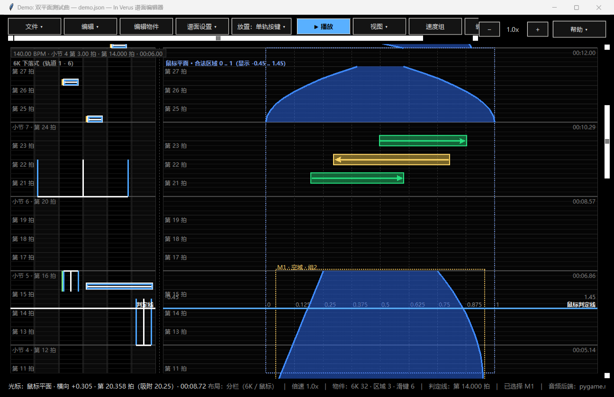
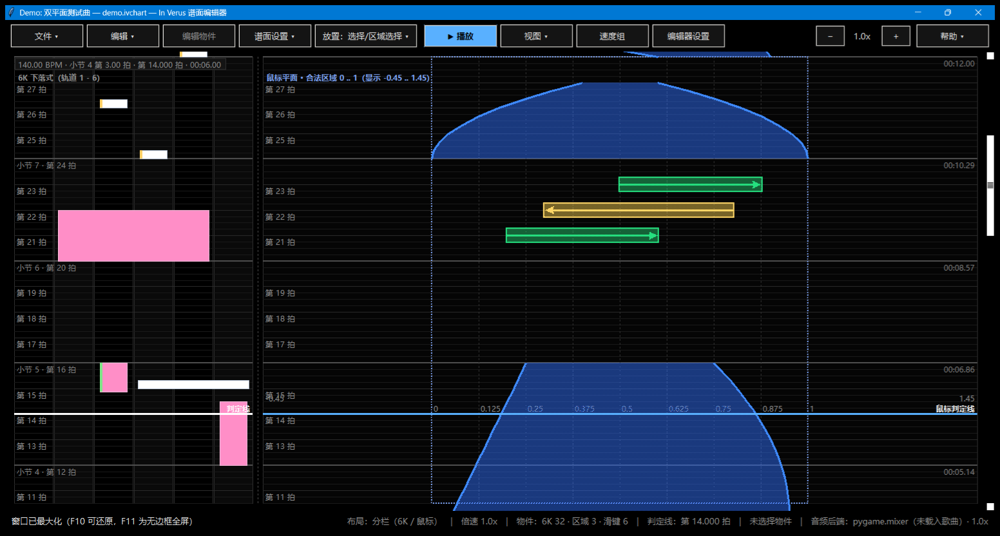
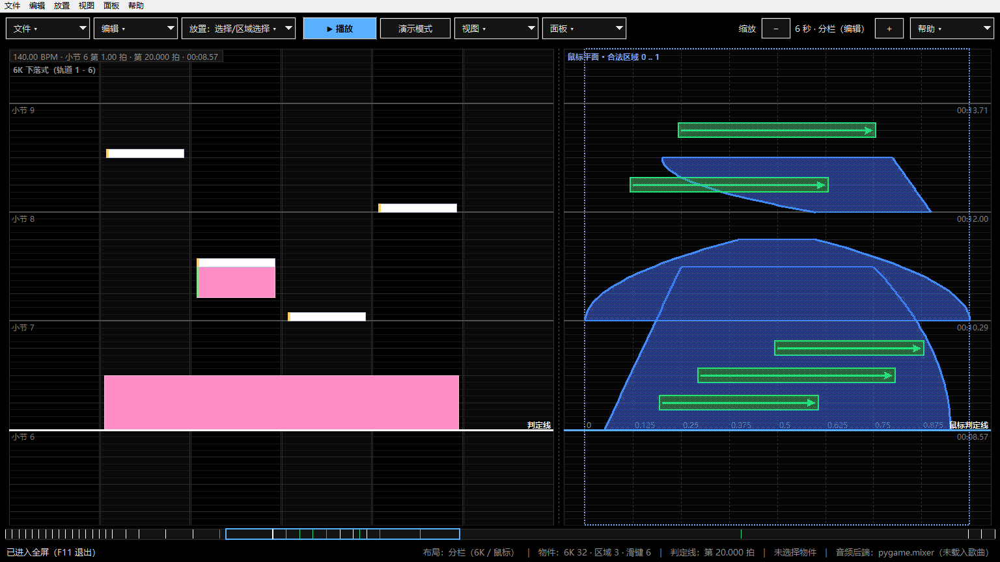
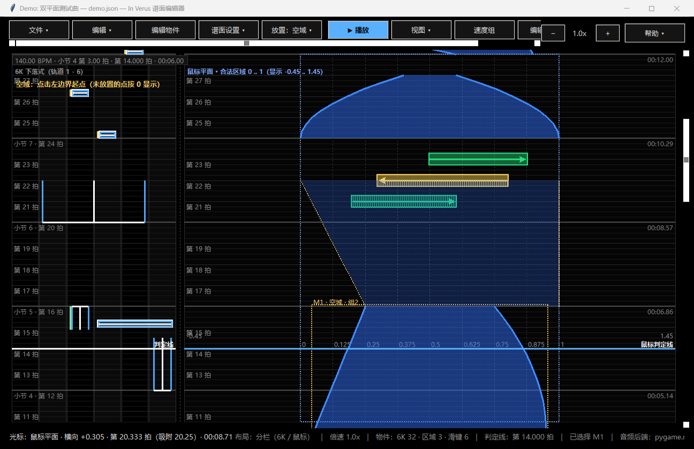
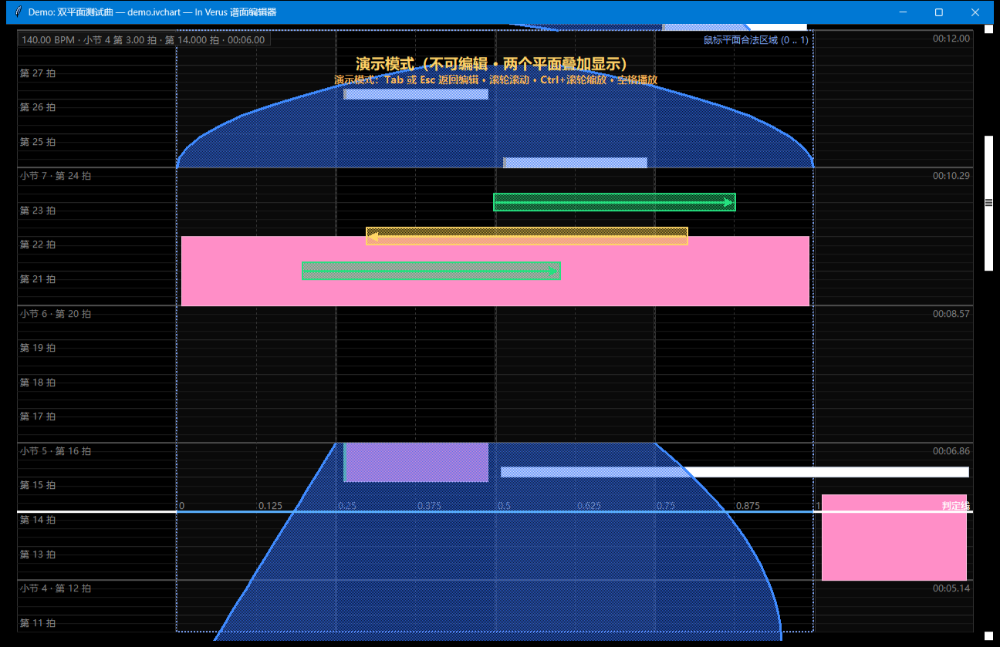

# In Verus —— 双平面音游 **谱面编辑器**

> 玩法为两个叠加平面：**6 轨下落式** + **鼠标平面（类接水果玩法）**。
> 仓库现在包含两部分：**编辑器**（tkinter，
un_editor.py）与
> **游玩器**（3D 视角，pygame，
un_player.py —— 判定 / 计分 / 结算）。
> 游玩器怎么玩见 [docs/PLAYER.md](docs/PLAYER.md)。

---

## 快速开始

```bash
# 1) 创建虚拟环境（Windows PowerShell）
python -m venv .venv
.\.venv\Scripts\Activate.ps1

# 2) 安装依赖（pygame-ce：真实音频播放；不装也能用，只是播放为静音时钟）
pip install -r requirements.txt

# 3) 生成示例谱面并启动编辑器
python run_editor.py --make-demo
python run_editor.py charts/demo/demo.json             # 默认最大化启动
python run_editor.py charts/demo/demo.json --windowed  # 普通窗口（F10 最大化 / F11 全屏）

# 或者双击 run_editor.bat（会自动优先使用 .venv）
```

游玩器（3D 视角，判定 / 计分 / 结算）：

```bash
python run_player.py                       # 主界面：↑↓ 选谱面 · Enter 开始 · O 打开其他 JSON · S 设置
python run_player.py charts/demo           # 每个含 json 的文件夹算一张谱面
python run_player.py charts/demo/demo.json # 直接选中示例谱面
```

玩法与判定规则见 [`docs/GAMEPLAY.md`](docs/GAMEPLAY.md)，
游玩器实现与操作见 [`docs/PLAYER.md`](docs/PLAYER.md)。

演示模式（两个平面叠加、只读、可滚动/缩放/播放）：

```bash
python run_editor.py charts/demo/demo.json --demo
```

自检（无需界面，校验时间轴换算 / 速度组积分 / 编辑命令 / 存档往返）：

```bash
python -m rhythm_editor.demo          # 需要先 pip install -e . 或设置 PYTHONPATH=src
python -m unittest discover -s tests -t . -v
```

---

## 界面预览

默认**最大化**启动（`F10` 最大化 / 还原，`F11` 无边框全屏）。编辑器把两个平面**左右分栏**：左边 6K 下落式、右边鼠标平面，
两边共用同一条判定线与同一套时间网格；顶部工具栏只有几个分组，具体功能收在二级菜单里：



默认启动状态（窗口最大化，保留标题栏与任务栏）：



无边框全屏（F11）：



放置流程中的幽灵预览（长按：起点已定，正在选择结束时刻，可滚动 / 缩放 / 点击任意位置）：



演示模式才把鼠标平面**叠加**到 6K 的中间四条轨道上（只读，支持滚动 / 缩放 / 播放暂停）：



---

## 玩法模型

### 平面一：6K 下落式

| 物件 | 数据 | 显示 |
| --- | --- | --- |
| 单轨按键 | 轨道 1 条 + 判定拍 | 实心蓝色细矩形 + 白边，白色横线压在节拍线上（矩形以判定时刻居中） |
| 多轨按键 | 横跨相邻多条轨道（`lane_start..lane_end`） | 同上，跨轨道 |
| 长按 | 开始拍 < 结束拍 | 实心蓝色矩形 + 白色竖线，开头套用单键样式（可跨轨道） |

### 平面二：鼠标平面（叠加在中间四条轨道上）

| 物件 | 规则 | 显示 |
| --- | --- | --- |
| 空域（原“停留区域”） | 出现期间鼠标必须留在空域内 | 半透明蓝色填充 + 只画左右两条不透明边界线 |
| 左右滑键 | 到达判定线时鼠标在滑键范围内朝指定方向滑动（滑动长度任意） | 半透明绿色填充 + 箭头 |
| 鼠标点击按键 | 到达判定线时鼠标在它的横向范围内点击（左键 / 右键均可） | 左右两条红色竖线 + 中间一条红色横线（间距 = 范围，粗细同 6K 中心实线）+ 中央固定大小的红色实心菱形；最上层 |

两个平面共用同一条判定线、同样的时间网格，滚动与缩放完全同步。

完整的判定语义（判定窗口、长按持续、空域逐帧检查、滑键最小位移、非法谱面降级策略）
写在 [`docs/GAMEPLAY.md`](docs/GAMEPLAY.md)，供下一步实现播放器使用。

---

## 编辑器功能对照

| 需求 | 实现位置 | 说明 |
| --- | --- | --- |
| (1) UI：两个区域 + 工具栏 | `ui/toolbar.py`、`ui/renderer.py`、`ui/view.py` | 编辑器左右分栏（左 6K / 右鼠标平面），**中间分界线可拖动、实时调整两栏宽度**（双击恢复 1:3），演示模式叠加；轨道边界、判定线、可调密度的节拍网格、合法区域边界、可选横向辅助网格、滚轮一格 = 一个网格格且自动吸附、判定线永远吸附网格、判定时间之后物件不再显示；纯黑背景；默认最大化；黑底分组按钮 + 二级菜单（无系统菜单栏） |
| 2-1 元数据 + 音频复制 | `ui/dialogs.py::MetadataDialog`、`io/chart_io.py` | 选择音频后复制到谱面文件所在文件夹，并在谱面中记录文件名 |
| 2-2 BPM 列表 + 偏移 | `ui/dialogs.py::BpmDialog`、`model/timing.py` | 每项：起始拍 / BPM / 每小节拍数；第 0 拍项不可删除；**BPM 变更处一定新开一小节**，并且**那里一定有一根小节线**（上一段末尾不完整的小节按一整节计入编号）；每小节拍数填 **0 = 关闭段内小节线**；纵向按秒线性，**BPM 变更后时间轴格子立刻改变大小** |
| 3 单轨 / 多轨 / 长按 | `ui/interactions.py` | 多轨以第一次点击时间轴为准；长按结束时刻可滚动缩放、可在任意位置（含鼠标区域）点击 |
| 4 空域 | `ui/interactions.py` + `NoteEditDialog` | 两次点击定开始/结束时间 → 依次点击左边界首尾、右边界首尾（未点击的点按左 0 / 右 1 预览）→ 弹窗选线型（线性 / 缓入 / 缓出），位置允许超出 0..1 |
| 5 左右滑键 | `ui/interactions.py` | 开启横向辅助网格时吸附到网格线并夹进 0..1，否则按鼠标真实位置（出界也照常放置）；第二次点击决定方向 |
| 5-2 鼠标点击按键 | `ui/interactions.py`、`ui/renderer.py` | 第一次点中心、第二次点旁边定大小；渲染成与 6K 按键同款的长方形 + 固定大小菱形；判定时左键 / 右键点击范围内即可；同一时刻只能有一个 |
| 6 编辑器设置 | `ui/dialogs.py::SettingsDialog` | 缩放（可视时长）、时间网格（一拍细分 n 份）、横向辅助（0..1 几等分，0=关闭）、系统音频延迟（ms） |
| 8 选择 / 复制 / 粘贴 / 镜像 / 编辑 | `model/document.py`、`ui/interactions.py` | 框选、Ctrl 对称差选择、粘贴保持轨道与横向位置、镜像沿游玩区中轴线、单选可编辑（`NoteEditDialog`） |
| 9 速度组 | `model/speed.py`、`ui/dialogs.py::SpeedGroupDialog` | 每条流速记录（起始拍 + 倍率，支持 0/负数反向）；物件与组双向记录；删除组时物件回到默认组；位置由“判定时刻在判定线上”反推 |
| 10 播放 / 暂停 | `audio.py`、`app.py` | 任意位置起播、延迟补偿、暂停时判定线吸附网格 |
| 11 演示模式 | `app.py::set_demo_mode` | 两平面叠加、只读、支持滚动 / 缩放 / 播放 / 暂停 |
| 12 节拍音 | `metronome.py`、`app.py::set_metronome` | 「视图 → 节拍音」：关闭（默认）/ 小节音 / 节拍音；播放时按小节线或整拍发一声“滴”，慢放不改变这声的长度 |
| 13 打击音效 + 音量 | `metronome.py::hits_between/hit_samples`、`ui/dialogs.py::VolumeDialog` | 「音效」菜单：打击音效开关、节拍音模式、音量…（音乐 / 节拍音 / 打击音，写入谱面 `editor` 段） |
| 14 侧轨高亮 / 放大 / 滚动条反向 | `ui/renderer.py`、`config.py`、`ui/view.py` | 视图菜单「侧轨高亮」（第 1 / 6 轨暗紫）；最大放大到 0.2 秒；右侧滚动条方向反向（1 = 曲首） |

> 速度组的流速可正可负并叠加，因此**物件位置不是判定时刻的单调函数**（远处的物件可能被
> 推回判定线上、近处的物件可能被甩出画面）。渲染剔除只看实际像素位置，命中测试与渲染
> 共用同一套几何 —— 详见 [`docs/DESIGN.md`](docs/DESIGN.md) 的“非单调速度”一节与
> [`docs/VERIFICATION.md`](docs/VERIFICATION.md) 的专项验证。

完整逐条规格见 [`docs/SPEC.md`](docs/SPEC.md)，玩法与判定规则见 [`docs/GAMEPLAY.md`](docs/GAMEPLAY.md)，
数据结构见 [`docs/CHART_FORMAT.md`](docs/CHART_FORMAT.md)，
操作说明见 [`docs/USER_GUIDE.md`](docs/USER_GUIDE.md)，架构设计见 [`docs/DESIGN.md`](docs/DESIGN.md)。

---

## 目录结构

```
run_editor.py            便捷启动脚本（无需安装）
run_editor.bat           Windows 启动脚本（优先使用 .venv）
requirements.txt         可选依赖说明（核心零依赖）
pyproject.toml           打包元数据（pip install -e . 可用）
charts/demo/demo.json    示例谱面（普通 JSON，由 python run_editor.py --make-demo 生成）
docs/                    规格、设计、格式与操作文档
src/rhythm_editor/
    app.py               主窗口、工具栏、事件、播放循环
    audio.py             音频后端（pygame.mixer 可选）+ 延迟补偿时钟
    config.py            常量与默认值
    demo.py              示例谱面构造 + 无界面自检
    io/chart_io.py       谱面 JSON 读写、音频复制
    model/               时间轴、物件、速度组、谱面、文档（撤销）
    ui/                  主题、视图变换、画布差分场景、渲染器、工具栏、对话框、交互状态机
tests/                   unittest 测试（含真实 Tk 画布冒烟测试）
tools/                   截图与验收辅助脚本
```

---

## 环境要求

* Python **3.10+**（开发与验证环境：Windows + Python 3.14 + Tk 9.0）
* 界面使用标准库 `tkinter`；**不需要**任何第三方包即可完整编辑
* 音频：`pygame-ce`（`requirements.txt` 里已列出，`pip install -r requirements.txt` 即可；
  本仓库的 `.venv` 里已安装 2.5.8）

若当前 Python 版本暂时没有 pygame 轮子，编辑器会自动退化为静音时钟后端，
状态栏会明确提示；滚动、缩放、播放进度、编辑功能全部照常工作。

### 状态栏显示「未安装 pygame / silent」怎么办

编辑器**不检查、也不切换解释器**：用哪个 Python 启动就用哪个（想要声音就让它装上
`pygame-ce`，或者激活 `.venv` 再启动）。推荐做法：

1. 双击 `run_editor.bat`（存在 `.venv` 时优先用它的解释器），
   或先激活虚拟环境再 `python run_editor.py …`。
2. 用 IDE（VS Code / PyCharm）运行时，把解释器选成 `.venv\Scripts\python.exe`。
3. 没有 `.venv` 就建一个：`python -m venv .venv` +
   `.\.venv\Scripts\python.exe -m pip install -r requirements.txt`。

自检命令：`.\.venv\Scripts\python.exe -c "import pygame; print(pygame.version.ver)"`
（有输出 = 这个解释器能发声）。

每次启动都会往 `_diag/audio_startup.log` 追加一行自检，写明**实际使用的 Python 路径**、
pygame / numpy 是否装上、音频设备是否正常 —— 排查“没有声音”时先看这个文件。
